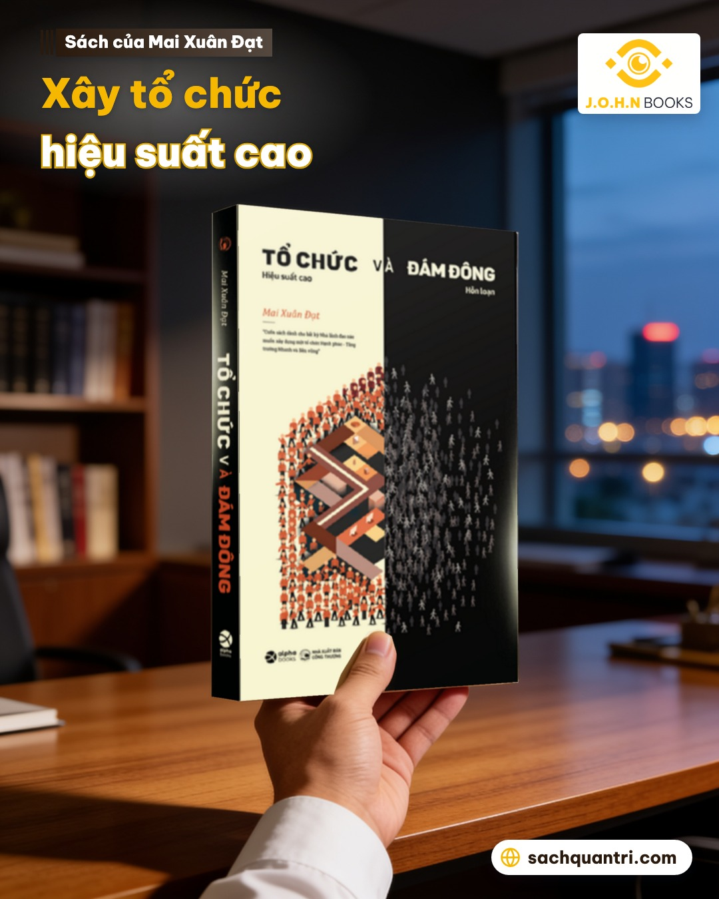
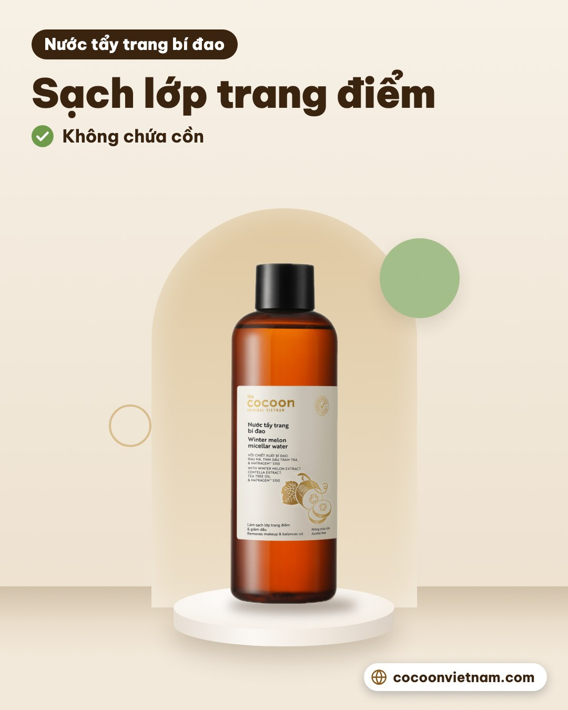

# Ảnh ví dụ: cùng một sản phẩm, mỗi đường vẽ ra đẹp tới đâu?

Trang này để bạn xem TRƯỚC khi chọn công cụ vẽ. Nói thẳng: **muốn ảnh đẹp như ảnh chụp thì cần gói ChatGPT, gói Gemini, hoặc chấp nhận trả tiền theo ảnh.** Chỉ dùng đường 0đ thì Agent nào (Claude Code, Codex, Antigravity) cũng chỉ làm ra ảnh kiểu đồ hoạ hoặc cảnh AI kém, dùng tạm được chứ không đẹp.

Skill giữ cho sản phẩm ĐÚNG ở mọi đường (đúng nhãn, đúng chữ, đúng số). Thứ khác nhau giữa các đường là ảnh có ĐẸP và có cảnh đời thật hay không.

## Bảng so nhanh

| Mức đẹp | Đường vẽ | Bạn tốn gì | Ảnh ra thế nào |
|---|---|---|---|
| ⭐⭐⭐⭐⭐ | **Gói ChatGPT Plus/Pro** (Codex vẽ) | 0đ thêm nếu đang trả gói | Cảnh đời thật, có người, tay cầm, ánh sáng tự nhiên. Đẹp nhất trong các đường đã đo. |
| ⭐⭐⭐⭐ (chưa đo được) | **Gói Google AI Pro/Ultra** (Antigravity vẽ) | 0đ thêm nếu đang trả gói; lượt vẽ theo tuần hay cạn | Cảnh đời thật, chữ Việt đúng dấu. Chưa đo được xem có giữ đúng sản phẩm không, vì cả ngày 15/11 lẫn 16/11/2026 gói đều báo hết lượt vẽ của tuần (số sao này là tạm chấm). |
| ⭐⭐⭐⭐⭐ | **Trả tiền theo ảnh** (Gemini API, Seedream 5.5) | khoảng 1.000–1.300đ/ảnh | Cảnh đời thật, ảnh có độ phân giải 2K. Đo Gemini API ngày 16/11/2026: ảnh đẹp ngang gói ChatGPT, tên sách trên bìa đúng hết. Seedream 5.5 chưa đo. |
| ⭐⭐⭐⭐ | **Seedream 4.5** (200 ảnh đầu miễn phí) | 0đ cho 200 ảnh đầu, cần thẻ để kích hoạt | Cảnh đời thật, đẹp thứ hai sau ChatGPT; nhưng chữ trên sản phẩm hay sai (bìa sách sai 5 chỗ), skill phải dán bìa/nhãn thật đè lên. |
| ⭐⭐⭐ | **Cloudflare miễn phí** | 0đ, khoảng 40 ảnh/ngày | Vẽ cảnh bàn có đạo cụ rồi ghép sản phẩm thật vào: sản phẩm đúng 100%, cảnh khá thật. Chỉ hợp sản phẩm đặt trên bàn/kệ; vẽ người, tay thì hay hỏng. |
| ⭐⭐ | **Không dùng AI vẽ** (Agent tự dựng bằng code) | 0đ | Ảnh đồ hoạ: sản phẩm thật đặt trên bục, nền màu, có chữ. Sạch, dễ đọc nhất, nhưng giống banner sàn thương mại, KHÔNG có cảnh đời thật. |

## Ảnh thật từng đường

Cùng một sản phẩm (sách "Tổ chức và Đám đông"), cùng thông điệp, cùng cỡ 4:5, làm ngày 16/11/2026. Bấm vào ảnh để xem to.

<!-- ANH-VI-DU: mỗi đường 1 tệp trong vi-du/anh/, tên đúng như dưới. Chưa có tệp thì để dòng "đang bổ sung". -->

| Đường vẽ | Ảnh | Skill đã làm gì |
|---|---|---|
| Gói ChatGPT |  | Vẽ 2 bản, giữ bản tay cầm tự nhiên hơn. Tên sách, tên tác giả, gáy đúng hết, không phải dán; chỉ câu trích li ti trên bìa bị sai chữ (lướt điện thoại không đọc tới). ~80 giây/ảnh. Người xem thử chấm ảnh này thuyết phục nhất. |
| Gói Gemini | (đang bổ sung: ngày 16/11/2026 thử thì gói báo hết lượt vẽ của tuần) | |
| Trả tiền theo ảnh (Gemini API) |  | Vẽ 2 bản, tốn 0,10 USD; giữ bản có cuốn sách nằm thấp để chừa chỗ đặt chữ. Tên sách, tên tác giả và gáy sách đều đúng, không cần dán chữ lên. Chỉ có logo nhà xuất bản li ti ở chân bìa bị vẽ sai; nửa bìa màu đen hơi ngả xanh. |
| Seedream 4.5 |  | Cảnh đẹp, nhưng AI viết sai 5 chỗ trên bìa ("ĐÂM ĐÔNG", "Mai Xuân Dạt", "Hởn loạn", gáy "Moi Xuân Dot"). Skill dán bìa trước + gáy thật đè lên, giữ ngón cái. |
| Cloudflare miễn phí (cảnh trống + ghép) |  | AI chỉ vẽ bàn làm việc có tách cà phê, kính, sổ, cây; skill đặt cuốn sách thật vào giữa, ám màu sách theo ánh sáng cảnh, bóng bám đúng mép đáy. Sách đúng 100%, nhìn kỹ vẫn biết là ảnh ghép. |
| Không dùng AI vẽ (dựng bằng code) |  | Sách thật tách nền đặt trên bục trắng, vòm màu nhạt. Đúng 100%, chữ dễ đọc nhất, nhưng là ảnh đồ hoạ, không có cảnh đời thật. ~10 giây. |

## Vậy nên chọn gì?

- **Đang trả ChatGPT Plus/Pro hoặc Google AI Pro:** dùng luôn gói đó, không tốn thêm đồng nào.
- **Chưa có gói nào, cần ảnh đẹp để chạy quảng cáo:** một gói ChatGPT Plus (khoảng 20 USD/tháng), 200 ảnh miễn phí của Seedream 4.5, hoặc trả theo ảnh (khoảng 1.000đ/ảnh) rẻ hơn nhiều so với thuê chụp.
- **Chỉ muốn 0đ:** vẫn làm được và sản phẩm vẫn đúng, nhưng hãy xem ảnh ở hàng cuối bảng trên trước để biết mình sẽ nhận được gì.
