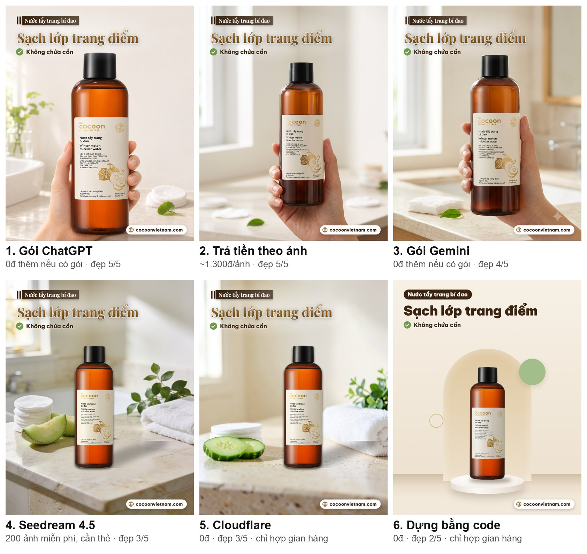
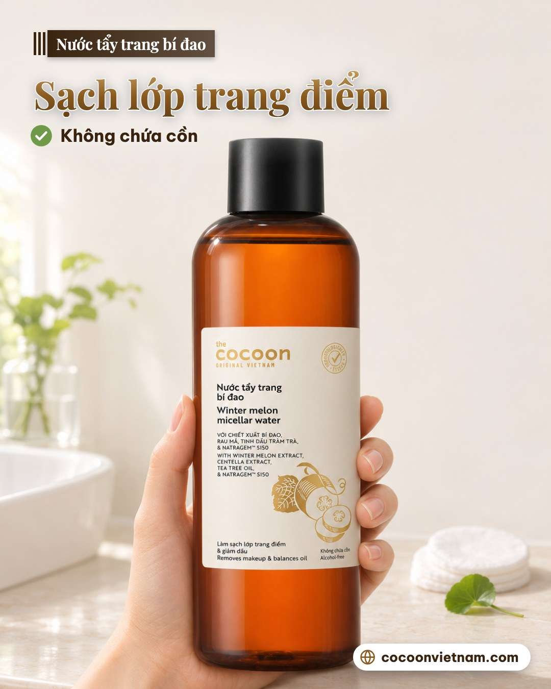
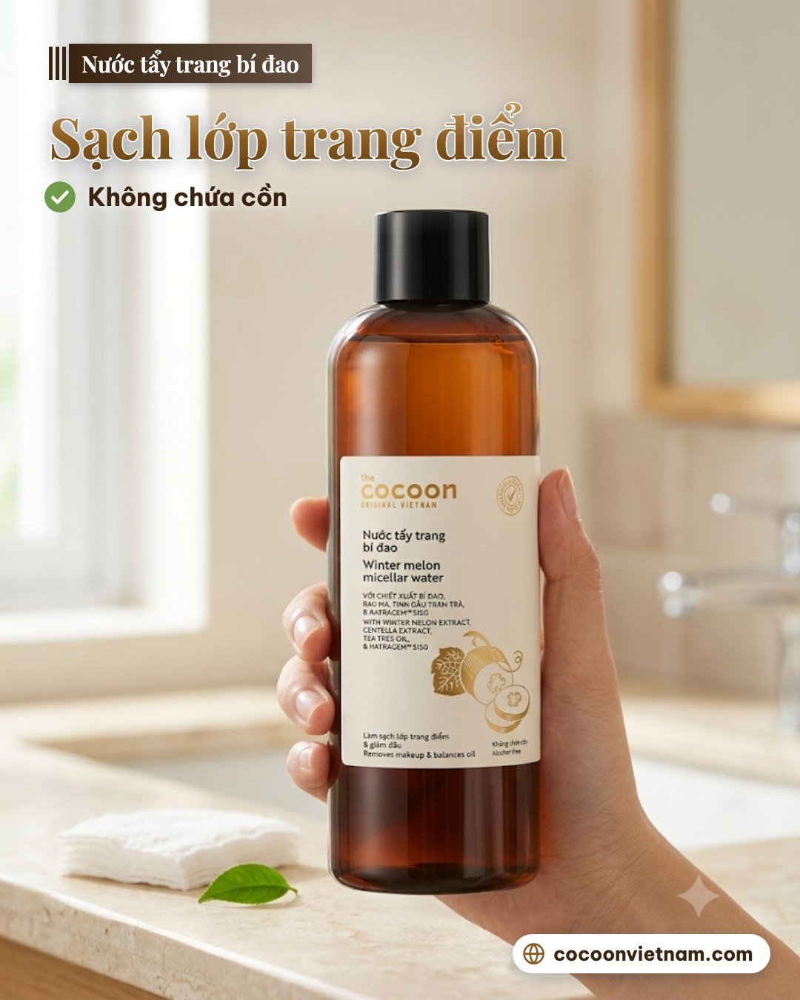
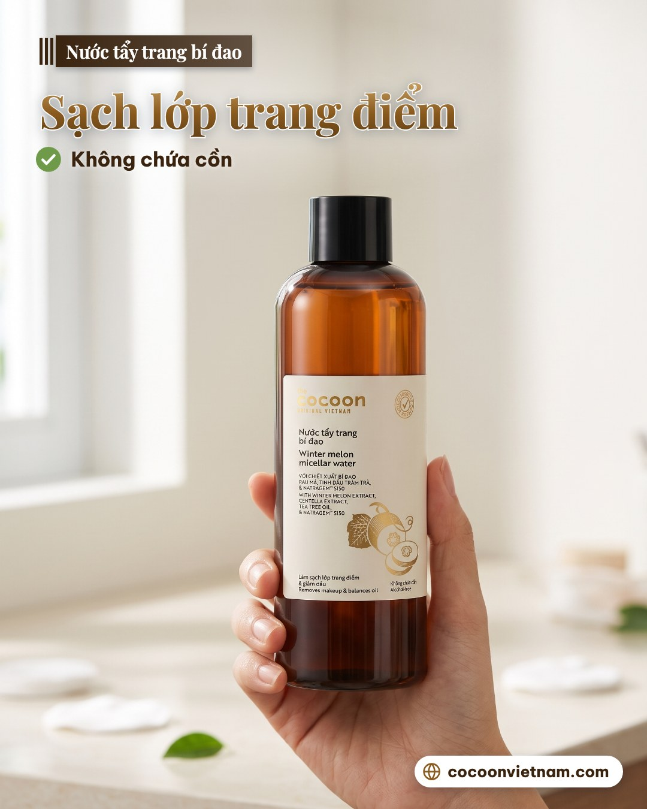

# Ảnh ví dụ: cùng một sản phẩm, mỗi đường vẽ ra đẹp tới đâu?

Trang này để bạn xem TRƯỚC khi chọn công cụ vẽ. Nói thẳng: **muốn ảnh đẹp như ảnh chụp thì cần gói ChatGPT, gói Gemini, hoặc chấp nhận trả tiền theo ảnh.** Chỉ dùng đường 0đ thì Agent nào (Claude Code, Codex, Antigravity) cũng chỉ làm ra ảnh kiểu đồ hoạ hoặc cảnh AI kém, dùng tạm được chứ không đẹp.

Skill giữ cho sản phẩm ĐÚNG ở mọi đường (đúng nhãn, đúng chữ, đúng số). Các đường này chỉ khác nhau ở chỗ ảnh ra có ĐẸP và có cảnh đời thật hay không.

## Bảng so nhanh

| Mức đẹp | Đường vẽ | Bạn tốn gì | Ảnh ra thế nào |
|---|---|---|---|
| ⭐⭐⭐⭐⭐ | **Gói ChatGPT Plus/Pro** (Codex vẽ) | 0đ thêm nếu đang trả gói | Ảnh trông như chụp thật, có người cầm sản phẩm, ánh sáng tự nhiên. Đẹp nhất trong các đường đã đo. |
| ⭐⭐⭐⭐ | **Gói Google AI Pro/Ultra** (Antigravity hoặc trang web Gemini vẽ) | 0đ thêm nếu đang trả gói; lượt vẽ theo tuần hay cạn | Cảnh đời thật, tên sản phẩm trên nhãn đúng. Thua ChatGPT ở chỗ ảnh nhỏ (khoảng 0,8 triệu điểm ảnh), chữ li ti trên nhãn sai vài chỗ, và có dấu ngôi sao Gemini ở góc dưới. |
| ⭐⭐⭐⭐⭐ | **Trả tiền theo ảnh** (Gemini API, Seedream 5.5) | khoảng 1.000–1.300đ/ảnh | Cảnh đời thật, ảnh có độ phân giải 2K. Kết quả đo Gemini API ngày 16/11/2026: ảnh đẹp ngang gói ChatGPT, tên sản phẩm đúng, chỉ sai vài chữ li ti trên nhãn. Seedream 5.5 chưa đo. |
| ⭐⭐⭐ | **Seedream 4.5** (200 ảnh đầu miễn phí) | 0đ cho 200 ảnh đầu, cần thẻ để kích hoạt | Cảnh đẹp, nhưng hay vẽ sai sản phẩm: lần thử với sách thì sai 5 chỗ trên bìa, lần này chai mỹ phẩm bị vẽ lộn ngược (nắp ở dưới) cả 2 lần. Skill phải dán nhãn thật đè lên, hoặc cho vẽ cảnh trống rồi ghép sản phẩm thật vào. |
| ⭐⭐⭐ | **Cloudflare miễn phí** | 0đ, khoảng 40 ảnh/ngày | Vẽ cảnh bàn có đạo cụ rồi ghép sản phẩm thật vào: sản phẩm đúng 100%, cảnh khá thật. Chỉ hợp với sản phẩm đặt trên bàn/kệ; khi vẽ người hoặc bàn tay thì hay hỏng. |
| ⭐⭐ | **Không dùng AI vẽ** (Agent tự dựng bằng code) | 0đ | Ảnh đồ hoạ: sản phẩm thật đặt trên bục, nền màu, có chữ. Sạch, dễ đọc nhất, nhưng giống banner sàn thương mại, KHÔNG có cảnh đời thật. |

## Cả 6 đường trong 1 ảnh

## Ảnh thật từng đường

Các ảnh dưới đây được làm ngày 16/11/2026, dùng cùng một sản phẩm phổ thông (nước tẩy trang bí đao Cocoon 500ml, ảnh lấy từ trang chính hãng), cùng thông điệp và cùng cỡ 4:5. Bấm vào ảnh để xem to.

<!-- ANH-VI-DU: mỗi đường 1 tệp trong vi-du/anh/, tên đúng như dưới. Chưa có tệp thì để dòng "đang bổ sung". -->

| Đường vẽ | Ảnh | Skill đã làm gì |
|---|---|---|
| Gói ChatGPT |  | Vẽ 1 bản là dùng được, khoảng 75 giây. Tên sản phẩm, logo, hình bí đao, cả dòng thành phần li ti đều đúng; máy đọc chữ đối chiếu với nhãn hãng không thấy chữ nào sai. Bàn tay tự nhiên, không che nhãn. |
| Gói Gemini |  | Antigravity báo đã hết lượt vẽ trong tuần, nên ảnh này được vẽ bằng ứng dụng Gemini trên web (tài khoản Google Workspace), với cùng ảnh mẫu và yêu cầu. Tên sản phẩm đúng; dòng thành phần li ti sai vài chữ ("AATRACEM", "NELON"). Ảnh ra 825×1024, có dấu ngôi sao Gemini ở góc phải dưới. |
| Trả tiền theo ảnh (Gemini API) |  | Vẽ 1 bản, tốn 0,05 USD, ảnh 2K. Tên sản phẩm đúng; chữ li ti sai: huy hiệu tròn thành chữ lạ, "Không chứa cồn" thành "Không chúa cồn". Chai hơi nhỏ trong khung. |
| Seedream 4.5 (cảnh trống + ghép) |  | Cho vẽ cả chai thì 2 lần đều ra chai lộn ngược (nắp ở dưới), chữ trên nhãn sai. Lỗi dáng lặp lại nên skill đổi cách: Seedream chỉ vẽ cảnh bồn rửa có bông tẩy trang, dưa lưới, khăn; skill ghép chai thật vào. Chai đúng 100%. |
| Cloudflare miễn phí (cảnh trống + ghép) |  | AI chỉ vẽ mặt đá có bông tẩy trang, dưa chuột, khăn, cây; skill đặt chai thật vào giữa, chỉnh màu chai cho hợp ánh sáng cảnh và đổ bóng sát đáy. Chai đúng 100%, nhìn kỹ vẫn biết là ảnh ghép, cảnh nhạt hơn Seedream. |
| Không dùng AI vẽ (dựng bằng code) |  | Chai thật tách nền đặt trên bục trắng, vòm màu kem. Đúng 100%, chữ dễ đọc nhất, nhưng là ảnh đồ hoạ, không có cảnh đời thật. Khoảng 10 giây. |

## Vậy nên chọn gì?

- **Đang trả ChatGPT Plus/Pro hoặc Google AI Pro:** dùng luôn gói đó, không tốn thêm đồng nào.
- **Chưa có gói nào mà cần ảnh đẹp để chạy quảng cáo:** mua gói ChatGPT Plus (khoảng 20 USD/tháng), dùng 200 ảnh miễn phí của Seedream 4.5 hoặc trả theo ảnh (khoảng 1.000đ/ảnh). Cách nào cũng rẻ hơn nhiều so với thuê chụp.
- **Chỉ muốn 0đ:** vẫn làm được và sản phẩm vẫn đúng, nhưng bạn cứ xem trước ảnh ở hàng cuối bảng trên để hình dung ảnh làm ra sẽ thế nào.
